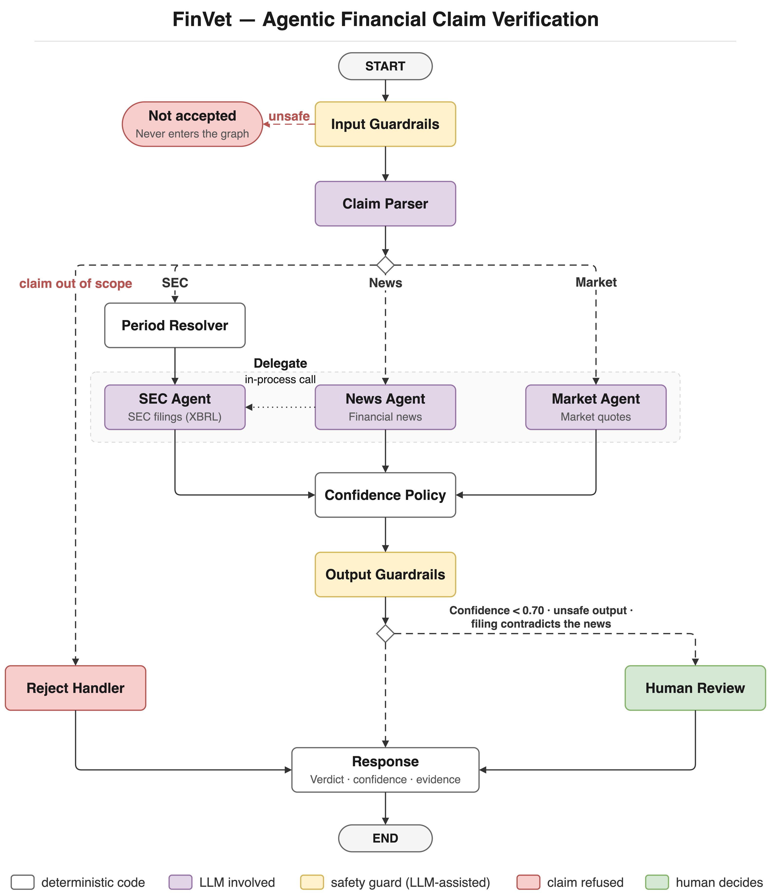
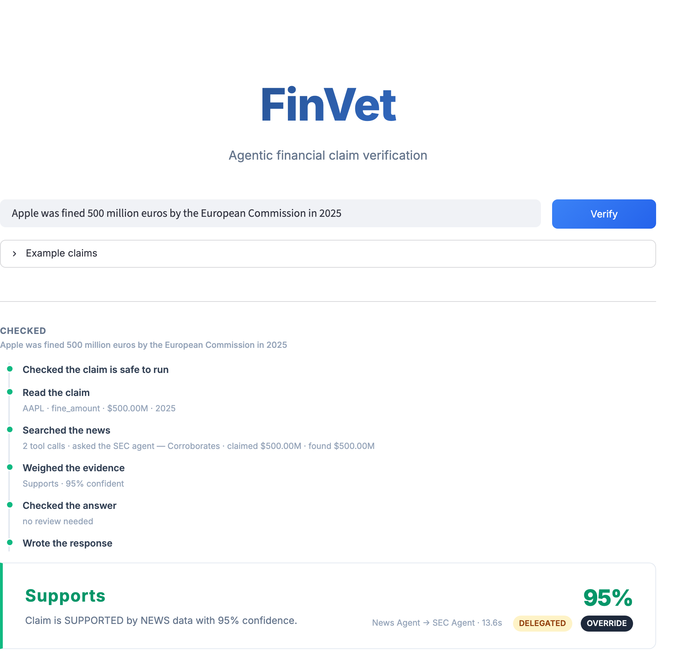

# FinVet

**Agentic financial claim verification.**

[](https://github.com/danielberhane/finvet/actions/workflows/ci.yml)
[](LICENSE)


FinVet verifies one financial claim at a time. Given *"Microsoft's fiscal 2025 revenue was
$282 billion,"* it returns a verdict of supported, refuted, or not enough information, a
confidence score, and the number it compared the claim against. Each response also names the
agent that answered, lists every tool call it made in order, and keeps an audit trail of the
run.

<p align="center">
  <a href="docs/diagrams/finvet-linkedin.png"></a>
</p>

> **Not financial advice.** A research and demonstration system; outputs may be wrong and must
> be independently verified. It applies model-risk principles but certifies nothing and is not
> a compliance product. Not affiliated with any data provider named here.

---

## Deterministic verdict override

The language model is responsible for retrieval only. It selects the tools, extracts the
figure from the filing or the quote, and proposes a verdict, but the returned verdict is
computed by comparing that figure to the claim under a fixed tolerance. Where the two
disagree, the computed verdict is retained and both are reported. Where no source yields a
figure, the claim is declined as not enough information.

---

## Evaluation

FinVet is evaluated at two levels: the full pipeline, from claim to verdict, and its RAG
component in isolation. The RAG component is a hybrid search over filing text that the SEC
agent invokes as a tool for claims about a filing's narrative sections, such as risk factors
or legal proceedings, where no reported figure applies.

**1) Claim verification.** The pipeline was evaluated on 325 held-out claims about 72
US-listed companies, each labelled with an expected verdict. Two models were run on identical
code, four runs each, so that the reliability of a verdict could be measured alongside its
accuracy. The claim set was constructed by the author; its composition and labelling are
described in the [dataset card](docs/eval/DATASET_CARD.md).

| Layer | DeepSeek-V4.1-Flash | Qwen3.8 |
|---|---|---|
| 1. Outcome — verdict accuracy | **97.3%** | **97.0%** |
| 2. Tool trajectory — tools called | 100% | 98.8% |
| 3. Grounding — numbers traced | **100%** | **100%** |
| 4. Calibration — decisive ECE | 0.049 | 0.050 |
| 5. Asymmetric risk, dangerous | 1 | **0** |
| 5. Asymmetric risk, declined | 2.2% | 3.1% |
| 6. Reliability — pass^4 | **95.4%** | **92.0%** |
| 7. Routing — expected path | 95.4% | 98.5% |

Rows 1 to 5 and 7 report each model's first run; the pass^4 row uses all four runs. Accuracy
is computed over 297 claims, excluding the 28 claims about live stock prices, whose answers
depend on the day of the run. Across all eight runs, one claim was answered wrongly, in two of
the four DeepSeek runs: a net loss was read as a gain. Every other miss was a decline or a
hand-off to a human reviewer.

**2) RAG component.** The search was evaluated on 50 held-out queries and the model's
explanations on 50 held-out claims.

| Test | n | Result |
|---|---|---|
| Finds the right passage in its top five | 30 queries | 24 of 30 (80%) |
| Ranks it near the top (mean reciprocal rank) | 30 queries | 0.68 |
| Returns nothing for off-topic or wrong-filing queries | 20 queries | 20 of 20 |
| Explanation stays inside the passages (RAGAS faithfulness) | 50 claims | 0.69 mean, 0.13 lowest |

Four of the six queries whose passage was absent from the top five returned a passage on the
same subject from another section of the same filing. No explanation determines a verdict: a
claim without a figure is declined.

The dataset, method and every run's results, with the files each number is computed from, are
in [`docs/eval/`](docs/eval/).

---

## Architecture

One agent runs per claim, chosen by claim type.

| Agent | Handles | Sources |
|---|---|---|
| **SEC** | GAAP financials, filing text | SEC EDGAR XBRL via MCP, hybrid RAG over filings |
| **Market** | Prices, valuation, market cap | Finnhub |
| **News** | Events, fines, settlements | Tavily search, and one-way delegation to SEC (cannot recurse) |

<p align="center">
  <a href="docs/diagrams/finvet-delegation-run.png"></a>
  <br><sub>A news claim settled by delegation: the SEC agent found the same &euro;500 million in Apple's filing.</sub>
</p>

**Controls.** Regex and PII guards screen every claim, with Llama Guard optional. Low
confidence, unsafe output, or a conflict between press and filing pauses the graph at a
checkpoint until a reviewer decides. Every tool call and verdict is persisted.

Full design, node by node: [`docs/ARCHITECTURE.md`](docs/ARCHITECTURE.md).

---

## Quickstart

```bash
git clone https://github.com/danielberhane/finvet.git && cd finvet
cp .env.example .env            # add DEEPSEEK_API_KEY, TAVILY_API_KEY, POSTGRES_PASSWORD
docker compose --profile sec up --build                  # --profile sec adds the SEC EDGAR MCP container
docker exec finvet-ollama ollama pull nomic-embed-text   # embeddings, one-time
# UI → http://localhost:8501   API → http://localhost:8000
```

---

## Limitations

**Claims.** One English sentence stating one fact about one US-listed company. Compound
claims are not decomposed; ranges, relative changes, and figures derived from other figures,
such as a fourth quarter computed from annual and nine-month totals, are declined rather than
estimated.

**Evidence.** A numeric verdict requires a structured source: an XBRL fact, a market quote, or
the deterministic fine and settlement extraction. The other 45 metrics the parser accepts
decline with a stated reason. Market data is the current delayed quote only; historical
prices fail closed.

**Evaluation.** Both evaluated models are mid-sized; no frontier model and no baseline system
were run on the same claims. The RAGAS faithfulness score rests on a second model's judgement
that has not been checked by hand.

**Deployment.** A single-process research system with no authentication, rate limiting or
tenant isolation ([SECURITY.md](SECURITY.md)); pending reviews are held in memory and do not
survive a restart. With the SEC MCP server or Ollama unavailable, claims decline or escalate
rather than fail.

---

## Contributing

Bug reports and focused fixes are welcome; see [CONTRIBUTING.md](CONTRIBUTING.md). For
vulnerability reports, see [SECURITY.md](SECURITY.md).

## Citation

To cite this software, use [CITATION.cff](CITATION.cff).

**Prior work.** FinVet v1 ([IEEE BigData 2025](https://ieeexplore.ieee.org/document/11400848),
with Duoduo Liao; [code](https://github.com/danielberhane/finvet-v1)) decided verdicts by
confidence-weighted vote over two retrieval pipelines. This release replaces that with one agent
per claim and a deterministic comparator.

## License

[Apache-2.0](LICENSE). FinVet runs third-party components without distributing them, notably
the AGPL-3.0 SEC EDGAR MCP server, which runs as its own container; see
[THIRD_PARTY_NOTICES.md](THIRD_PARTY_NOTICES.md). Users must honor each provider's terms,
including the [SEC Fair Access policy](https://www.sec.gov/os/webmaster-faq#developers).
