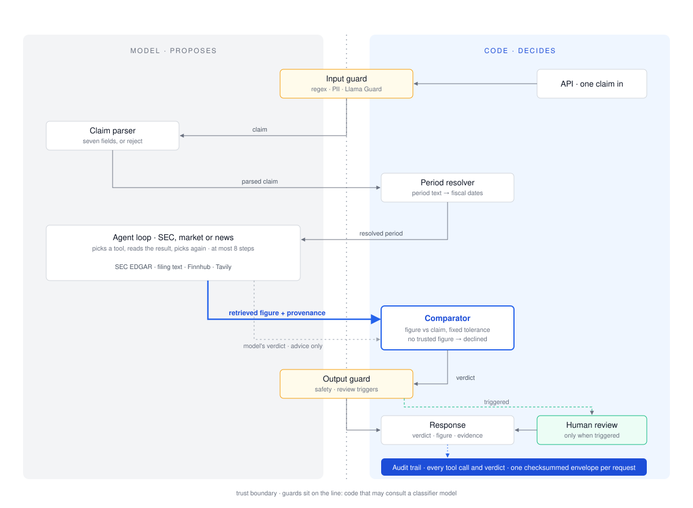

# FinVet — System Architecture

For the engineer or reviewer who has read the README and wants the design: how a claim
moves, where the verdict is decided, what the model may and may not do, what is stored,
and how to run the system.

## 1. System overview

The model proposes and code decides. The model parses the claim and runs the agent loop;
code computes the verdict from the retrieved figure, consults a human only when a
guardrail triggers, and records every step. The guardrails sit on the boundary: code that
may consult a classifier model. Three things cross it: the claim going in, the retrieved
figure with its provenance going to the comparator, and the verdict going out.

<p align="center"></p>

## 2. Interfaces

`src/finvet/main.py` creates the app, compiles the graph and registers the routers.

| Method | Path | Purpose |
|---|---|---|
| `GET` | `/health`, `/` | Health; reports the models this process will use |
| `GET` | `/stats` | Service info and agents |
| `POST` | `/verify` | Verify a claim |
| `POST` | `/verify-stream` | Same, with progress events streamed to the UI |
| `GET` | `/reviews` | Pending human reviews |
| `POST` | `/review/{id}` | Submit a review decision |
| `POST` | `/review/{id}/reconcile` | Retry the audit write for a stuck review |
| `POST` | `/memory-check` | Similar past verifications |
| `POST` | `/memory-accept` | Record that a cached result was used |
| `GET` | `/audit` | List executions by verdict, agent, date |
| `GET` | `/audit/{id}` | Full audit trail for one request |
| `POST` | `/search-history` | Past verifications, seven-day window |

## 3. A claim's path

`src/finvet/graph/workflow.py` registers twelve nodes. At most nine run for one claim:
one of the three agents, and the two review nodes only when a review is required.

| # | Node | After | Purpose |
|---|---|---|---|
| 1 | `input_guardrails` | entry | Regex guard; Llama Guard when enabled |
| 2 | `claim_parser` | 1 | Model extracts the seven-field ParsedClaim; routes by claim type |
| 3 | `period_resolver` | 2 (sec) | Period text to canonical dates |
| 4 | `sec_agent` | 3 | SEC verification |
| 5 | `market_agent` | 2 (market) | Market verification |
| 6 | `news_agent` | 2 (news) | News verification |
| 7 | `reject_handler` | 2 (reject) | Verdict REJECTED with a reason |
| 8 | `confidence_adjuster` | 4, 5, 6 | Fixed confidence adjustments, capped at 0.95 |
| 9 | `output_guardrails` | 8 | Output safety; routes to review or response |
| 10 | `hitl_gate` | 9 | The graph pauses here |
| 11 | `apply_hitl_decision` | 10 | Applies the reviewer's decision |
| 12 | `response_generator` | 7, 9, 11 | Final response |

ParsedClaim (`src/finvet/models/claim.py`) has seven fields: `claim_type`, `ticker`,
`metric`, `operator`, `value`, `period`, `reject_reason`. The metric must come from the
vocabulary in `src/finvet/config/metrics.py`; a `range` operator declines.

## 4. Where the verdict is decided

Every agent extends `BaseVerificationAgent` (`src/finvet/agents/base.py`) and runs the
same four steps:

```
1. Context: the claim, its parsed fields, the resolved period, the company.
2. Agent loop, up to 8 tool calls (AGENT_MAX_ITERATIONS): the model picks a tool,
   reads the result, picks again, until it answers without one.
3. Verdict call: a separate structured call that sees the evidence but not the
   loop's reasoning, so it cannot anchor on it.
4. Override: code compares the retrieved figure with the claim under a fixed
   tolerance (1.5% for SEC values above $1B, 2% at or below, 5% for market and news;
   src/finvet/config/constants.py). Where the model's verdict differs, the computed one is kept
   and both are reported.
```

The figure in step 4 must be a trusted observation (`src/finvet/models/evidence.py`):
an XBRL line item for the resolved period, a timestamped market quote, or a penalty
amount extracted from filing text by code. Nothing the model wrote qualifies; without
one, the claim is NOT_ENOUGH_INFO.

| Agent | Tools | Sources |
|---|---|---|
| SEC | statements, filings list, company info, filing-text search | SEC EDGAR XBRL, filing text |
| Market | quote, prices, company overview, earnings | Finnhub |
| News | news search, source check, delegation to SEC | Tavily; SEC by delegation |

Each agent binds only the tools in its row; filing-text and delegation results are kept
whole as provenance; prompts are text files in `src/finvet/agents/prompts/`.

## 5. Evidence sources

**SEC XBRL.** The SEC EDGAR MCP server is called by
`src/finvet/mcp/sec_edgar.py`. For a claim that names a fiscal period, the fact is
selected from the issuer's own company facts by period end and duration, statement
forms only, most recently filed value first (`src/finvet/mcp/fact_selection.py`).

**Market.** Finnhub REST via `src/finvet/mcp/finnhub.py`.

**Filing text.** For claims about narrative sections, the SEC agent searches an index of
filing passages (`src/finvet/rag/service.py`, tool `src/finvet/tools/filing_search.py`):
hybrid search, vector similarity and full-text rank fused by reciprocal rank, filtered
to the resolved period. A relevance floor of 0.55 on vector similarity, measured on 30
positive and 30 negative query/ticker pairs, stops the nearest neighbour from standing
in for an absent disclosure; below it the tool returns `no_relevant_evidence`, and with
no indexed filing for the issuer, `no_corpus`. Passages reach the model inside
`<filing_excerpt>` delimiters as evidence, never as instructions.

**News.** Tavily search via `src/finvet/tools/tavily_search.py`; secondary to a filing,
never decisive for a number on its own.

## 6. Delegation, News to SEC

A news claim about a fine or settlement is checked against the issuer's own filing. The
two metrics that take this path, `fine_amount` and `settlement_amount`, are the only
numeric metrics with no XBRL concept. Code, not the model, extracts the amount from the
Legal Proceedings section, and only when exactly one candidate appears
(`src/finvet/tools/filing_amounts.py`). The delegation is one hop, in process, and one
way: the SEC agent holds no delegation tool, so it cannot recurse.

`corroborate_with_filing` (`src/finvet/tools/corroborate_sec.py`) is reached either by
the model during the loop or by the news node afterwards. Its nine statuses are in
`src/finvet/models/a2a.py`. Only `CONTRADICTS` escalates, by adding the
`source_disagreement` review trigger. `NO_MATCHING_DISCLOSURE` requires a successful
search in the nested run; without one the status is `SOURCE_UNAVAILABLE`, because only
something that read a filing may say what it does not contain. Silence never escalates:
a periodic report omits most things, and routing every omission to a reviewer would
teach them to ignore the flag.

## 7. Controls

**Guardrails** (`src/finvet/guards/`):

| Provider | When | Checks |
|---|---|---|
| `RegexGuardProvider` | always, input | injection patterns, PII, length 10 to 2000, NFKC normalisation, language |
| `LlamaGuardProvider` | optional, input and output | Llama Guard 3 via Ollama; S6 (specialized advice) on output only |
| `FinancialGuardProvider` | always, output | investment-advice patterns |
| `CompositeGuardProvider` | chain | runs the providers in order and stops at the first failure |

If Ollama is down, Llama Guard reports safe with the flag `llama_guard_unavailable`; the
regex guard still runs.

**Review gate.** Three triggers send a claim to a human
(`src/finvet/graph/nodes/output_guardrails.py`): `low_confidence` below
`CONFIDENCE_THRESHOLD_HITL` (0.70), `output_safety_violation`, and `source_disagreement`.
The graph pauses before `hitl_gate` and the reviewer approves, overrides or rejects.

**Review lifecycle** (`src/finvet/api/routes/review.py`). The verdict column doubles as
the review state:

```
PENDING --claim--> REVIEWING --finalize--> terminal verdict
                       |
                       +-- failure before invoke --> PENDING (retryable)
                       +-- invoke began, no durable outcome --> REVIEW_FINALIZATION_FAILED
```

The call to `invoke` is the point of no return: before it the claim goes back to
`PENDING`; from it onward the claim is never released, because a second reviewer could
resume a partly executed graph. `reconcile` retries the audit write and never re-runs
the graph. Checkpoints live in process memory (`MemorySaver`), so pending reviews do not
survive a restart.

**Integrity** (`GET /audit/{id}`, `src/finvet/audit/integrity.py`). Three statuses:
`verified`, the checksum recomputes and every displayed field matches the envelope;
`failed`, the checksum mismatched or a field diverges; `unavailable`, not checkable, with
the reason `no_checksum_recorded`, `review_in_progress` or `review_finalization_failed`.
The checksum is recomputed before any lifecycle reasoning, so a corrupted row under
review reports `failed`.

## 8. What is stored

PostgreSQL 16 with pgvector (`src/finvet/audit/models.py`, `src/finvet/rag/models.py`).

- **`audit_events`**: append-only, one row per event: pipeline steps, tool calls, review
  decisions, guard violations.
- **`audit_executions`**: one row per request; `full_trace` is the execution envelope
  and `execution_hash` the SHA-256 over it, re-verified on read; `data_sources` holds
  `{xbrl, rag, a2a}`.
- **`filing_chunks`**: passage text with its filing identity (ticker, CIK, form, filing
  date, period end, part, item, section, chunk index, a content-derived `evidence_id`),
  an embedding with an HNSW index, and a full-text vector with a GIN index.
- **Claim memory**: a LangGraph `PostgresStore`, off by default
  (`src/finvet/memory/store_service.py`); its output is prior model output, not a source.

Every retrieved passage keeps its chunk id, filing, period, section, the query that found
it, both arm scores and a SHA-256 of its text, so what the model read can be
reconstructed exactly.

## 9. Security properties

Properties of the code, not of configuration. A regression in any of them is a security
bug ([SECURITY.md](../SECURITY.md) says how to report one).

- **Claim text cannot steer the model unchecked.** Input passes the regex guard and, when
  enabled, Llama Guard. Requests reject unknown fields; a free-form context field was
  removed because it was an injection channel.
- **No model-authored number reaches a verdict.** Verdicts are computed from a trusted
  observation with provenance; without one the claim returns `NOT_ENOUGH_INFO`.
- **Agents stay in their lanes.** Each binds only its own tools, and the SEC agent holds
  no delegation tool.
- **Credentials do not cross providers.** Each model role names the environment variable
  holding its key; a role pointed at a new provider without that key raises
  (`src/finvet/llm/factory.py`).

## 10. Configuration

| Variable | Required | Default | Description |
|---|---|---|---|
| `DEEPSEEK_API_KEY` | Yes | — | Key for the default model provider |
| `TAVILY_API_KEY` | Yes | — | News search |
| `POSTGRES_PASSWORD` | Yes | — | Database password |
| `FINNHUB_API_KEY` | No | — | Market data; without it market claims decline as NOT_ENOUGH_INFO |
| `FINNHUB_MOCK_MODE` | No | false | Mock market data instead of live Finnhub |
| `SEC_EDGAR_USER_AGENT` | No | `FinVet (your@email.com)` | Contact string SEC requires; set your own |
| `FINVET_BIND_ADDR` | No | 127.0.0.1 | Address the compose ports bind to; see SECURITY.md before changing |
| `ENABLE_LLAMA_GUARD` | No | false | Llama Guard on input and output |
| `ENABLE_CLAIM_MEMORY` | No | **false** | Claim memory (experimental; its output is prior model output, not a source) |
| `CONFIDENCE_THRESHOLD_HITL` | No | 0.70 | Below this, a claim goes to review |
| `LOG_LEVEL` | No | INFO | Logging level |
| `LLM_PARSER__MODEL`, `LLM_AGENT__MODEL`, `LLM_VERDICT__MODEL` | No | deepseek-chat | Model per role; `__BASE_URL` and `__API_KEY_ENV` point a role at any OpenAI-compatible endpoint |

Tracing is off by default; when enabled, it sends claim text, tool outputs and prompts to
LangSmith.

## 11. Running it

| Service | Image | Port | Purpose |
|---|---|---|---|
| `postgres` | `pgvector/pgvector:pg16` | 5432 | audit, memory, filing index |
| `api` | `docker/Dockerfile` | 8000 | FastAPI |
| `ui` | `docker/Dockerfile` | 8501 | Streamlit |
| `sec-edgar-mcp` | `docker/Dockerfile.sec`, profile `sec` | 9870 | SEC EDGAR MCP server |
| `ollama` | `ollama/ollama` | 11434 | embeddings; Llama Guard when enabled |

Every port binds to `${FINVET_BIND_ADDR:-127.0.0.1}`. To run the API and UI natively,
start only the services in containers (`docker compose --profile sec up -d postgres
sec-edgar-mcp`), pull `nomic-embed-text` into Ollama, then start `uvicorn finvet.main:app
--port 8000 --app-dir src` and `streamlit run ui/app.py --server.port 8501`.
