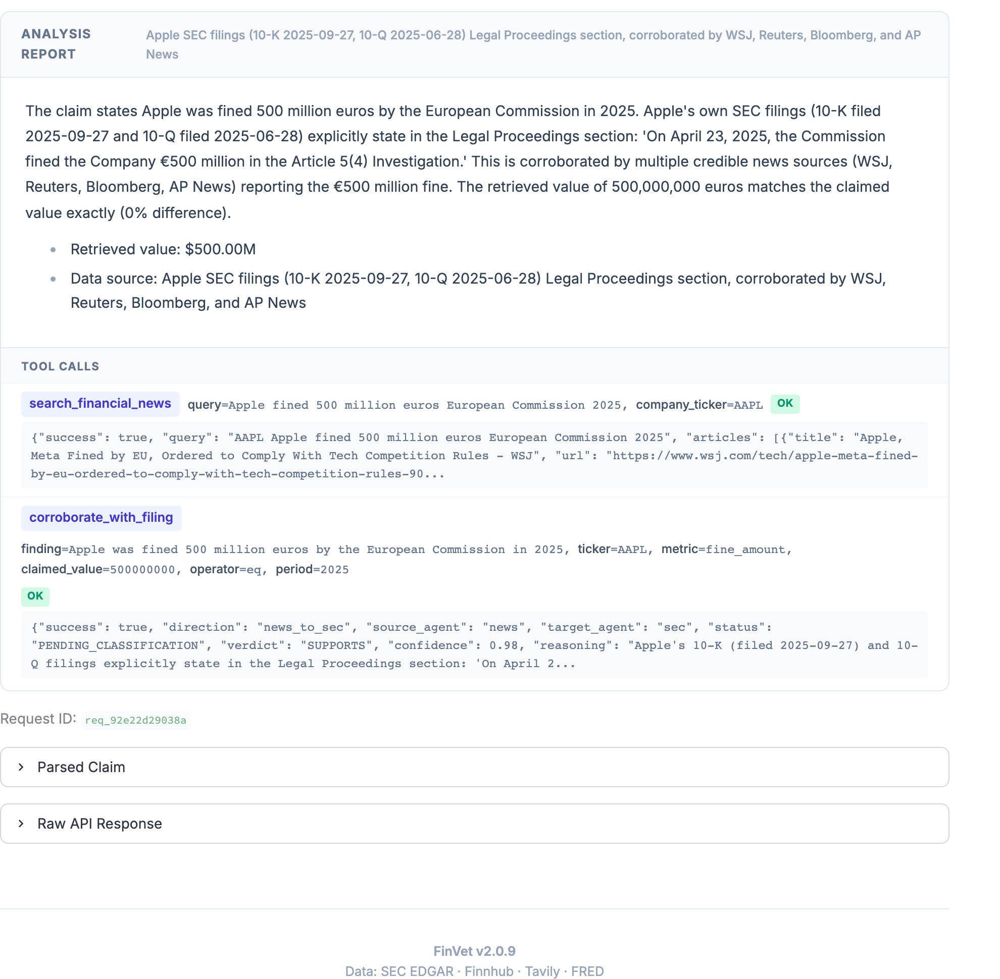

# FinVet — System Architecture

FinVet verifies one financial claim at a time. The language model retrieves evidence and
proposes a verdict; the verdict that is returned is computed in code from a trusted
observation under a fixed tolerance, and a claim with no such observation is declined.
This document follows a claim through the system. The README has the picture
(`docs/diagrams/finvet-linkedin.png`).

## 1. System overview

```
Streamlit UI (:8501)
       |  HTTP
FastAPI API (:8000)
       |
LangGraph pipeline (12 nodes, pauses for human review)
       |
  SEC Agent ------> SEC EDGAR MCP (:9870) ---> XBRL facts and filings
  ^    |                                            |
  |    +---------> filing-text search (pgvector + full text) <+
  |                                                 |
  | delegation: corroborate_with_filing             |
  |                                                 |
  News Agent -----> Tavily news search              |
                                                    |
  Market Agent ---> Finnhub REST                    |
                                                    |
                   PostgreSQL 16 + pgvector (:5432) |
                   audit_events, audit_executions,  |
                   filing_chunks; memory store when |
                   enabled                       <--+
```

## 2. Interfaces

`src/finvet/main.py` creates the app, compiles the graph and registers the routers.

| Method | Path | Purpose | Audit events |
|---|---|---|---|
| `GET` | `/health`, `/` | Health; reports the models this process will use | — |
| `GET` | `/stats` | Service info and agents | — |
| `POST` | `/verify` | Verify a claim | `input_received`, `commit_execution` |
| `POST` | `/verify-stream` | Same, with progress events streamed to the UI | as `/verify` |
| `GET` | `/reviews` | Pending human reviews | — |
| `POST` | `/review/{id}` | Submit a review decision | `hitl_{decision}` |
| `POST` | `/review/{id}/reconcile` | Retry the audit write for a stuck review | — |
| `POST` | `/memory-check` | Similar past verifications | — |
| `POST` | `/memory-accept` | Record that a cached result was used | `memory_cache_accepted` |
| `GET` | `/audit` | List executions by verdict, agent, date | — |
| `GET` | `/audit/{id}` | Full audit trail for one request | — |
| `POST` | `/search-history` | Past verifications, seven-day window | — |

Request models reject unknown fields (`src/finvet/api/models.py`). The only prior
context a request may carry is the identifier of an earlier verification, which the
server resolves from its own store.

## 3. A claim's path

`src/finvet/graph/workflow.py` registers twelve nodes. At most nine run for one claim:
one of the three agents, and the two review nodes only when a review is required.

| # | Node | After | Decides | Purpose |
|---|---|---|---|---|
| 1 | `input_guardrails` | entry | — | Regex guard; Llama Guard when enabled |
| 2 | `claim_parser` | 1 | claim type | Model extracts the seven-field ParsedClaim |
| 3 | `period_resolver` | 2 (sec) | — | Period text to canonical dates |
| 4 | `sec_agent` | 3 | — | SEC verification |
| 5 | `market_agent` | 2 (market) | — | Market verification |
| 6 | `news_agent` | 2 (news) | — | News verification |
| 7 | `reject_handler` | 2 (reject) | — | Verdict REJECTED with a reason |
| 8 | `confidence_adjuster` | 4, 5, 6 | — | Fixed confidence adjustments |
| 9 | `output_guardrails` | 8 | review needed | Output safety and the review triggers |
| 10 | `hitl_gate` | 9 | — | The graph pauses here |
| 11 | `apply_hitl_decision` | 10 | — | Applies the reviewer's decision |
| 12 | `response_generator` | 7, 9, 11 | — | Final response |

Routing after the parser is by `claim_type`: `reject` to the reject handler, `sec` to the
period resolver and then the SEC agent, `market` and `news` to their agents. After the
output guardrails, a claim goes to the review gate if any trigger fired, otherwise to
the response.

The confidence node applies fixed adjustments from `src/finvet/config/constants.py`
(a penalty for a large difference, bonuses for a close match and for a thorough search,
equality claims only) and caps automated confidence at 0.95.

**ParsedClaim**, the parser's contract (`src/finvet/models/claim.py`):

| Field | Values |
|---|---|
| `claim_type` | `sec`, `market`, `news`, `reject` |
| `ticker` | symbol or null |
| `metric` | a name from the metric vocabulary (`src/finvet/config/metrics.py`) or null |
| `operator` | `eq`, `gt`, `gte`, `lt`, `lte`, `approx`, `range`; a `range` claim declines |
| `value` | number or null |
| `period` | period text or null |
| `reject_reason` | `non_financial`, `question`, `incomplete`, or null |

## 4. Where the verdict is decided

Every agent extends `BaseVerificationAgent` (`src/finvet/agents/base.py`) and runs the
same sequence:

```
1. Build the context: claim, parsed fields, resolved period, company.
2. Agent loop, up to 8 iterations (AGENT_MAX_ITERATIONS): the model picks a tool,
   the result is appended (cut at 50,000 characters), and the model picks again,
   until it answers without a tool call. Results of provenance tools are kept whole.
3. Verdict call: a separate structured model call that sees the evidence but not
   the loop's final reasoning, so it cannot anchor on it.
4. Override: code compares the retrieved figure with the claim.
     equality:  |claimed − retrieved| / max(|claimed|, |retrieved|) within tolerance
     direction: a plain comparison for gt, gte, lt, lte
     tolerance: 1.5% for SEC values above $1B, 2% at or below, 5% market, 5% news
   Where the model's verdict differs, the computed one is kept and both are reported.
5. Return the evidence record.
```

The figure in step 4 must be a trusted observation (`src/finvet/models/evidence.py`):
an XBRL line item for the resolved period, a quote from the timed market tool
(`get_stock_quote`), or a penalty amount extracted from filing text by code. Nothing
the model wrote qualifies. Without one, the claim is NOT_ENOUGH_INFO.

| Agent | Tools | Sources | Kept whole |
|---|---|---|---|
| SEC | company info, recent filings, income statement, balance sheet, cash flow, `search_filing_text`, `search_past_verifications` | SEC EDGAR XBRL, filing text | `search_filing_text` |
| Market | quote, daily prices, company overview, earnings, `search_past_verifications` | Finnhub | — |
| News | news search, source check, `search_past_verifications`, `corroborate_with_filing` | Tavily; SEC by delegation | `corroborate_with_filing` |

Each agent binds only the tools in its row. `search_past_verifications` answers
"Memory search unavailable." unless claim memory is enabled. System prompts are text
files in `src/finvet/agents/prompts/`.

## 5. Evidence sources

**SEC XBRL.** The SEC EDGAR MCP server (port 9870) is called over streamable HTTP by
`src/finvet/mcp/sec_edgar.py`. For a claim that names a fiscal period, the fact is
selected from the issuer's own company facts by period end and duration, statement
forms only, most recently filed value first (`src/finvet/mcp/fact_selection.py`).

**Market.** Finnhub REST via `src/finvet/mcp/finnhub.py`. Historical candles need a paid
tier; the free tier's 403 is raised, not hidden. Mock mode exists for tests.

**Filing text.** For claims about narrative sections (risk factors, legal proceedings,
discussion), the SEC agent searches an index of filing passages
(`src/finvet/rag/service.py`, tool `src/finvet/tools/filing_search.py`):

```
query --> embedding (local Ollama, nomic-embed-text, 768 dims)
            |
     +------+------+
  pgvector       full text
  cosine, top 20 ts_rank, top 20
     +------+------+
            |
  reciprocal rank fusion, k = 60
            |
        top results
```

Retrieval is filtered to the resolved period. A relevance floor of 0.55 on vector
similarity stops the nearest neighbour from standing in for an absent disclosure; it was
measured on 30 positive and 30 negative query/ticker pairs, and
`scripts/build_rag_manifest.py` regenerates the evidence. Below the floor the tool
returns no passages with reason `no_relevant_evidence`; with no indexed filing for the
issuer, `no_corpus`. Passages reach the model inside `<filing_excerpt>` delimiters, and
the prompt states that text inside them is evidence, never an instruction.

**News.** Tavily search via `src/finvet/tools/tavily_search.py`. Press coverage is
secondary to a filing and never decides a numeric verdict on its own.

## 6. Delegation, News to SEC

A news claim about a fine or settlement is checked against the issuer's own filing. The
two metrics that take this path, `fine_amount` and `settlement_amount`, are the only
numeric metrics with no XBRL concept. Code, not the model, extracts the amount from the
Legal Proceedings section, and only when exactly one candidate appears
(`src/finvet/tools/filing_amounts.py`). The delegation is one hop, in process, and one
way: the SEC agent holds no delegation tool, so it cannot recurse. The delegated run has
the same iteration budget as a normal run (`A2A_MAX_ITERATIONS`).

Two triggers reach `corroborate_with_filing` (`src/finvet/tools/corroborate_sec.py`):
the model calls it during the loop, or the news node calls it afterwards for a
corroboration metric with a ticker. A filing that closed before the event is
`NOT_APPLICABLE_YET` and no nested run happens.

| Status | Meaning |
|---|---|
| `PENDING_CLASSIFICATION` | placeholder before the parent verdict exists |
| `CORROBORATES` | the press figure and the filing figure agree |
| `CONTRADICTS` | they disagree; the only status that escalates |
| `NO_MATCHING_DISCLOSURE` | an applicable filing was searched and said nothing |
| `FOUND_UNCERTIFIED` | passages were read and no amount could be extracted |
| `NOT_APPLICABLE_YET` | the newest filing closed before the event |
| `SOURCE_UNAVAILABLE` | nothing was successfully searched |
| `NO_CORPUS` | no filing is indexed for the issuer |
| `FAILED` | the delegation or its search errored |

`CONTRADICTS` adds the `source_disagreement` review trigger; no other status does.
`NO_MATCHING_DISCLOSURE` requires a successful `search_filing_text` in the nested run;
without one the status is `SOURCE_UNAVAILABLE`, because only something that read a
filing may say what it does not contain. Silence never escalates: a periodic report
omits most things, and routing every omission to a reviewer would teach them to ignore
the flag (`src/finvet/models/a2a.py`).

<p align="center">
  <a href="diagrams/finvet-delegation-evidence.png"></a>
  <br><sub>A delegated run's evidence panel: every tool call with its arguments and raw
  response, including the delegation and what the SEC agent returned.</sub>
</p>

## 7. Controls

**Guards** (`src/finvet/guards/`):

| Provider | When | Checks |
|---|---|---|
| `RegexGuardProvider` | always, input | injection patterns, PII, length 10 to 2000, NFKC normalisation, language |
| `LlamaGuardProvider` | optional, input and output | Llama Guard 3 via Ollama; category S6 tuned for finance |
| `FinancialGuardProvider` | always, output | investment-advice patterns |
| `CompositeGuardProvider` | chain | runs the providers in order and stops at the first failure |

If Ollama is down, Llama Guard reports safe with the flag `llama_guard_unavailable`; the
regex guard still runs.

**Review gate.** Three triggers send a claim to a human (`src/finvet/graph/nodes/output_guardrails.py`):
`low_confidence` below `CONFIDENCE_THRESHOLD_HITL` (0.70), `output_safety_violation`, and
`source_disagreement`. The graph pauses before `hitl_gate`, the API answers
`pending_review`, and the reviewer approves, overrides or rejects.

**Review lifecycle** (`src/finvet/api/routes/review.py`). The verdict column doubles as
the review state:

```
PENDING --claim--> REVIEWING --finalize--> terminal verdict
                       |
                       +-- failure before invoke --> PENDING (retryable)
                       +-- invoke began, no durable outcome --> REVIEW_FINALIZATION_FAILED
```

The call to `invoke` is the point of no return: before it, nothing of the graph has run
and the claim goes back to `PENDING`; from it onward the claim is never released, because
a second reviewer could resume a partly executed graph. `POST /review/{id}/reconcile`
retries the audit write from the checkpoint and never re-runs the graph. Checkpoints live
in process memory (`MemorySaver`), so pending reviews do not survive a restart; after one,
reconcile answers `checkpoint_unavailable` and the claim must be re-run.

**Integrity** (`GET /audit/{id}`, `src/finvet/audit/integrity.py`). Three statuses:
`verified`, the checksum recomputes and every displayed field matches the envelope;
`failed`, the checksum mismatched or a field diverges; `unavailable`, not checkable, with
the reason `no_checksum_recorded`, `review_in_progress` or `review_finalization_failed`.
The checksum is recomputed before any lifecycle reasoning, so a corrupted row under
review reports `failed`.

## 8. What is stored

PostgreSQL 16 with pgvector (`src/finvet/audit/models.py`, `src/finvet/rag/models.py`).

- **`audit_events`**: append-only, one row per event. Twelve event types:
  `input_received`, `claim_parsed`, `period_resolved`, `tool_called`,
  `output_guardrails_checked`, `hitl_gate_reached`, `hitl_approved`, `hitl_overridden`,
  `hitl_rejected`, `memory_cache_accepted`, `prior_verification_attached`,
  `guardrail_violation`.
- **`audit_executions`**: one row per request. `full_trace` is the execution envelope
  and `execution_hash` the SHA-256 over it, re-verified on read. `data_sources` holds
  `{xbrl, rag, a2a}` and is indexed.
- **`filing_chunks`**: passage text with its filing identity (ticker, CIK, form, filing
  date, period end, part, item, section, chunk index, a content-derived `evidence_id`),
  an embedding with an HNSW index, and a generated full-text vector with a GIN index.
- **Claim memory**: a LangGraph `PostgresStore` opened by `main.py` only when
  `ENABLE_CLAIM_MEMORY=true` (`src/finvet/memory/store_service.py`). Its output is prior
  model output, not a source. Thresholds: 0.95 to reuse a verdict, 0.75 to give an
  agent context, 0.60 to show similar claims.

Every retrieved passage keeps its chunk id, filing, period, section, the query that found
it, both arm scores and a SHA-256 of its text, through response metadata into
`data_sources`, so what the model read can be reconstructed exactly.

## 9. Security properties

Properties of the code, not of configuration. A regression in any of them is a security
bug ([SECURITY.md](../SECURITY.md) says how to report one).

- **Claim text cannot steer the model unchecked.** Input passes the regex guard and, when
  enabled, Llama Guard. Requests reject unknown fields; a free-form context field was
  removed because it was an injection channel.
- **No model-authored number reaches a verdict.** Verdicts are computed from a trusted
  observation with provenance; without one the claim returns `NOT_ENOUGH_INFO`.
- **Agents stay in their lanes.** Each binds only its own tools, and the SEC agent holds
  no delegation tool.
- **Credentials do not cross providers.** Each model role names the environment variable
  holding its key; a role pointed at a new provider without that key raises
  (`src/finvet/llm/factory.py`).

## 10. Configuration

| Variable | Required | Default | Description |
|---|---|---|---|
| `DEEPSEEK_API_KEY` | Yes | — | Key for the default model provider |
| `TAVILY_API_KEY` | Yes | — | News search |
| `POSTGRES_PASSWORD` | Yes | — | Database password |
| `FINNHUB_API_KEY` | No | — | Market data; without it market claims decline as NOT_ENOUGH_INFO |
| `FINNHUB_MOCK_MODE` | No | false | Mock market data, tests only |
| `SEC_EDGAR_USER_AGENT` | No | `FinVet (your@email.com)` | Contact string SEC requires; set your own |
| `FINVET_BIND_ADDR` | No | 127.0.0.1 | Address the compose ports bind to; see SECURITY.md before changing |
| `ENABLE_LLAMA_GUARD` | No | false | Llama Guard on input and output |
| `ENABLE_CLAIM_MEMORY` | No | **false** | Claim memory (experimental; its output is prior model output, not a source) |
| `CONFIDENCE_THRESHOLD_HITL` | No | 0.70 | Below this, a claim goes to review |
| `LOG_LEVEL` | No | INFO | Logging level |
| `LLM_PARSER__MODEL`, `LLM_AGENT__MODEL`, `LLM_VERDICT__MODEL` | No | deepseek-chat | Model per role; `__BASE_URL` and `__API_KEY_ENV` point a role at any OpenAI-compatible endpoint |

All three roles run at temperature 0. DeepSeek has no `json_schema` response mode, so
structured output uses `json_mode` with the schema in the prompt.

**Tracing.** Off by default. Set `LANGCHAIN_TRACING_V2=true`, `LANGCHAIN_API_KEY` and
`LANGCHAIN_PROJECT`, then restart the API; each request becomes one LangSmith trace
carrying its `request_id`. Enabling it sends claim text, tool outputs and prompts to
LangSmith.

## 11. Running it

| Service | Image | Port | Purpose |
|---|---|---|---|
| `postgres` | `pgvector/pgvector:pg16` | 5432 | audit, memory, filing index |
| `api` | `docker/Dockerfile` | 8000 | FastAPI |
| `ui` | `docker/Dockerfile` | 8501 | Streamlit |
| `sec-edgar-mcp` | `docker/Dockerfile.sec`, profile `sec` | 9870 | SEC EDGAR MCP server |
| `ollama` | `ollama/ollama` | 11434 | embeddings; Llama Guard when enabled |

Every port binds to `${FINVET_BIND_ADDR:-127.0.0.1}`. To run the API and UI natively,
start only the services in containers (`docker compose --profile sec up -d postgres
sec-edgar-mcp`), pull `nomic-embed-text` into Ollama, then start `uvicorn finvet.main:app
--port 8000 --app-dir src` and `streamlit run ui/app.py --server.port 8501`.
